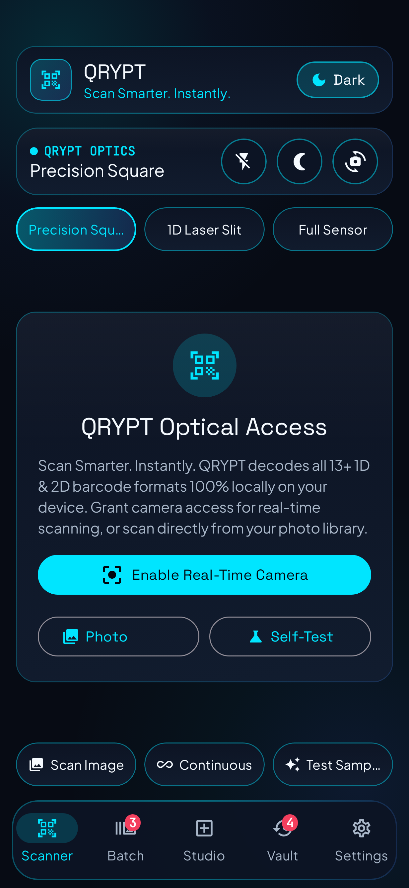
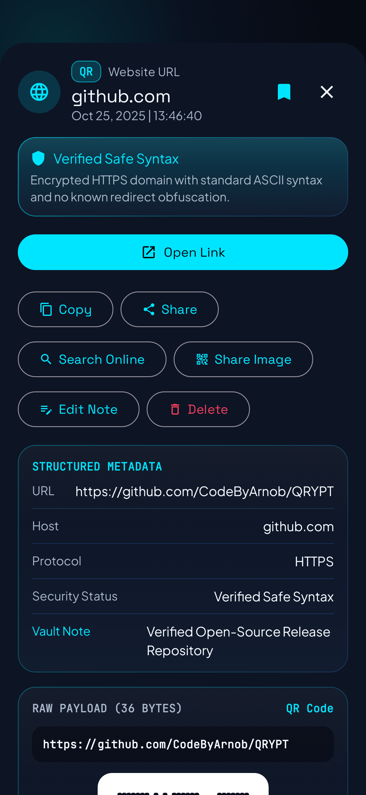
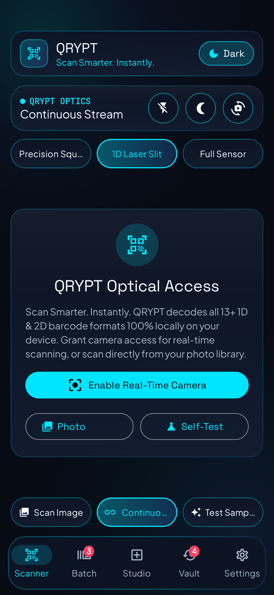
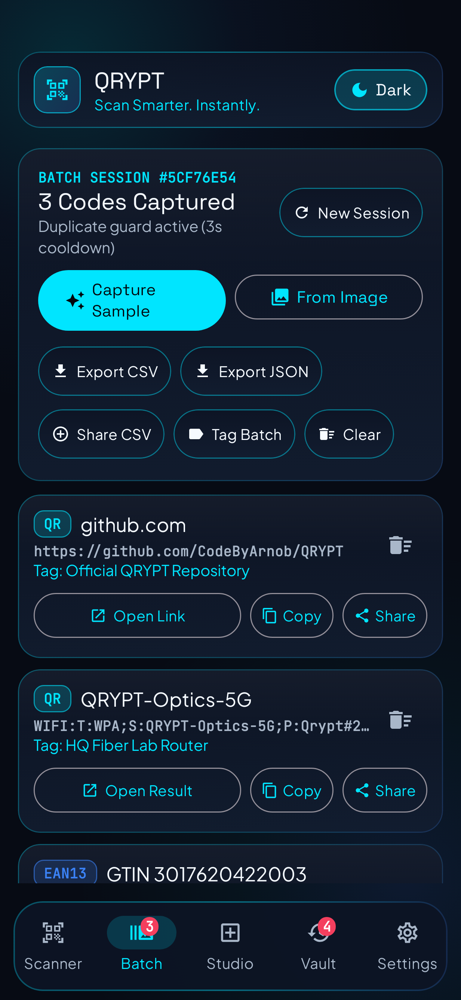
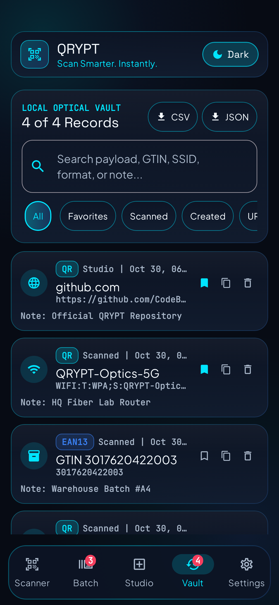
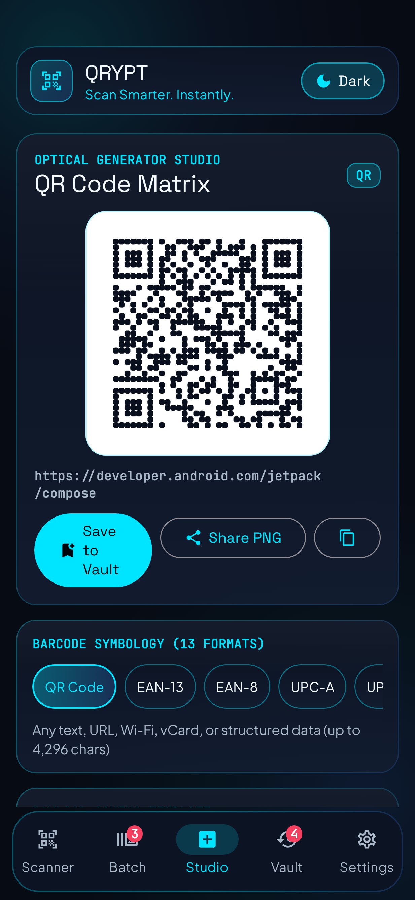
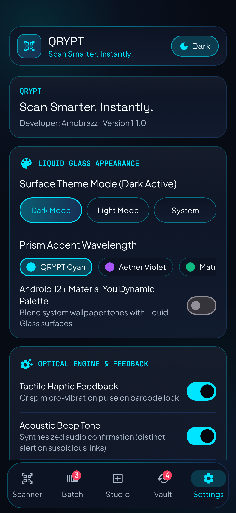
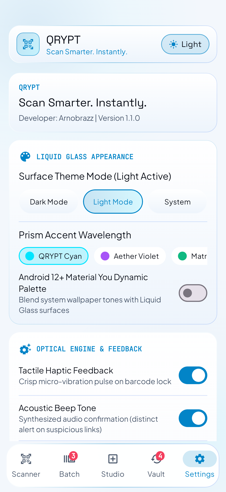

<div align="center">


# QRYPT QR & Barcode Scanner

**Scan Smarter. Instantly.**

[](https://github.com/CodeByArnob/QRYPT/actions/workflows/ci.yml)
[](https://github.com/CodeByArnob/QRYPT/releases)
[](https://codebyarnob.github.io/QRYPT/)
[](LICENSE)
[](https://developer.android.com)
[](https://developer.android.com/jetpack/compose)

<br />

<a href="https://codebyarnob.github.io/QRYPT/">
  
</a>

<br />

**QRYPT** is a high-precision Android QR and 13-format barcode scanner, smart result action engine, retail product identifier (powered by Open Food Facts with local Room caching), batch inventory processor, anti-phishing URL inspector, local Room SQLite history vault, and 1024px to 1536px optical QR studio engineered by **ArnobRazz** with **Kotlin**, **Jetpack Compose (Material 3)**, **CameraX**, **Google ML Kit**, and **ZXing**.

[**Download for Android (v1.1.0 APK)**](https://github.com/CodeByArnob/QRYPT/releases/download/v1.1.0/QRYPT-v1.1.0-release.apk) | [**Live Product Page**](https://codebyarnob.github.io/QRYPT/) | [**Release Notes & SHA-256**](https://github.com/CodeByArnob/QRYPT/releases/tag/v1.1.0) | [**Privacy Policy**](PRIVACY_POLICY.md) | [**Security Policy**](SECURITY.md)

</div>

---

## Table of Contents

1. [Product Overview & Design System](#product-overview--design-system)
2. [Verified Features](#verified-features)
3. [Smart Scan Result Actions & Product Identification](#smart-scan-result-actions--product-identification)
4. [Genuine Application Screenshots](#genuine-application-screenshots)
5. [Supported QR & Barcode Formats](#supported-qr--barcode-formats)
6. [Technical Architecture & Stack](#technical-architecture--stack)
7. [Privacy & Permissions Explained](#privacy--permissions-explained)
8. [Installation, Download & SHA-256 Verification](#installation-download--sha-256-verification)
9. [Building & Testing From Source](#building--testing-from-source)
10. [Troubleshooting & FAQ](#troubleshooting--faq)
11. [Contributing, Security & License](#contributing-security--license)

---

## Product Overview & Design System

QRYPT combines low-latency on-device optical decoding with a refined **Liquid Glass** interface crafted for clarity, speed, and user-controlled privacy:

1. **Midnight Navy Dark Palette**: Built around `#070B14` primary backgrounds, `#0D1424` and `#121D30` elevated surfaces, `#00E5FF` vivid cyan optical accents, `#3B82F6` electric blue highlights, `#F5FAFF` high-contrast primary typography, and `#A9B7C9` readable cool gray copy.
2. **Frosted Daylight Light Theme**: Adaptive high-contrast light palette (`#F4F7FB` canvas with `#0D1526` slate ink and `#0284C7` optical cyan) with a 1-tap header toggle and Android 12+ Material You Dynamic Color support.
3. **On-Device Optical Engine with Scoped Product Lookup**: Every camera frame, gallery image, anti-phishing URL check, batch export, and generated barcode runs 100% locally on your device. When you scan a retail product barcode (`EAN-13`, `EAN-8`, `UPC-A`, `UPC-E`, `ISBN`), QRYPT queries the public Open Food Facts v3 HTTPS endpoint using only the numeric barcode and caches the product locally in Room SQLite.

---

## Verified Features

### 1. Real-Time CameraX + Google ML Kit Optical Scanner
1. **Low-Latency Frame Analysis**: Uses `ImageAnalysis.STRATEGY_KEEP_ONLY_LATEST` backpressure with bundled Google ML Kit Barcode Scanning (`17.3.0`) so frames are analyzed immediately on-device.
2. **3 Viewfinder Target Modes**: Switch on the fly between **Precision Square** (QR and 2D matrix), **1D Laser Slit** (narrow horizontal window for dense retail/industrial barcodes), and **Full Sensor**.
3. **Optical Controls**: Two-finger pinch-to-zoom, smooth zoom slider, tap-to-focus metering, hardware Torch toggle, Front/Back lens switch, and real-time Y-plane ambient luma calculation with automatic **Low-Light Exposure Boost** (< 45 lux).

### 2. Smart Scan Result Actions & Safe External Intents
1. **Context-Aware Result Sheet**: Every scan opens a structured bottom sheet displaying the decoded payload, detected content type, security verification badge, and one-tap actions: **Open Link** for websites, **View Product** for identified retail barcodes, **Call** for phone numbers, **Send Email** for email addresses, **Send Message** for SMS payloads, **View Location** for geographic coordinates, **Add Contact** for vCard/MECARD contacts, **Add to Calendar** for calendar events, **Copy**, **Share**, and **Search Online**.
2. **Mandatory External Action Confirmation**: QRYPT never automatically opens an external link after scanning. Tapping **Open Link** displays a confirmation dialog showing the full destination URL and any security warnings before opening your browser.
3. **Unsafe URI Scheme Blocking**: Strictly blocks `javascript:`, `data:`, `file:`, `vbscript:`, `intent:`, `content:`, `about:`, `blob:`, and `jar:` schemes.

### 3. Product Identification from Barcodes (Open Food Facts + Room Cache)
1. **Supported Product Symbologies**: Automatically validates and identifies `EAN-13`, `EAN-8`, `UPC-A`, `UPC-E`, `ISBN-10`, `ISBN-13`, and `GTIN-14` barcodes with Modulo-10 checksum verification and GS1 country prefix lookup.
2. **Rich Product Metadata**: Retrieves product name, brand, product photo, package quantity, categories, ingredients, allergens, Nutri-Score grade (`A` to `E`), NOVA processing group (`1` to `4`), and nutrition facts per 100g (`kcal`, fat, sugars, proteins, salt) from Open Food Facts (`https://world.openfoodfacts.org/api/v3/product/{barcode}.json`).
3. **Offline Room Caching & Graceful States**: Fetched products are cached in Room SQLite (`product_cache`) for instant offline retrieval. Clearly handles Loading, Verified Product, Product Not Found, Offline Mode, Invalid Barcode, and Network Timeout states.

### 4. Zero-Permission Photo Library & Built-In Self-Test
1. **System Photo Picker (`PickVisualMedia`)**: Decode single or multiple barcodes from saved screenshots and gallery images without requesting `READ_MEDIA_IMAGES` or `READ_EXTERNAL_STORAGE`.
2. **Multi-Angle ZXing Recovery**: Automatically falls back across `HybridBinarizer`, `GlobalHistogramBinarizer`, rotated bitmaps (`90`, `180`, `270` degrees), and center-crop passes for dense or tilted images.
3. **Optical Engine Self-Test**: Built-in verification menu that synthesizes real barcode bitmaps (Wi-Fi, Retail EAN-13 `3017620422003`, vCard, HTTPS URL, and Phishing Warning) and passes them through the optical decoder pipeline on-device.

### 5. High-Speed Batch & Continuous Inventory Mode
1. **Multi-Scan Session Queue**: Capture dozens of barcodes in rapid succession with configurable duplicate cooldown suppression (`1` to `15` seconds) and inline smart action buttons (**Open Link**, **View Product**, **Copy**, **Share**) on every captured item.
2. **Bulk Warehouse Tagging**: Attach batch notes/tags to an entire session and export RFC-4180 **CSV** or structured **JSON** files via Android's `FileProvider` share sheet.

### 6. Local Optical Vault (Room SQLite) & 13-Format Generator Studio
1. **Local Optical Vault (`prism_scan_vault.db`)**: Full-text search across titles, raw payloads, and user annotations with 9 category filters (`All`, `Favorites`, `URLs`, `Wi-Fi`, `Products`, `Contacts`, `Calendar`, `Geo/Comms`, `Created in Studio`) and one-tap vault purge.
2. **13-Format Generator Studio**: Generate **URL**, **Wi-Fi Network**, **vCard 3.0 Contact**, **Plain Text**, **Retail GTIN (EAN/UPC)**, **Email**, **SMS**, **Phone**, **Geo Coordinates**, and **Calendar Event (`VEVENT`)** codes at `512px`, `1024px HD`, or `1536px Print` resolution.

---

## Smart Scan Result Actions & Product Identification

| Scanned Content Type | Automatic Detection & Validation | Primary & Secondary Smart Actions |
| :--- | :--- | :--- |
| **Website URL (`http` / `https`)** | Validates syntax, blocks unsafe URI schemes, and runs offline anti-phishing checks (Punycode, raw IP, shorteners, cleartext HTTP). | **Open Link** (with confirmation dialog), **Copy**, **Share**, **Search Online** |
| **Product Barcode (`EAN-13`, `EAN-8`, `UPC-A`, `UPC-E`, `ISBN`)** | Validates GS1 Modulo-10 check digit, resolves GS1 country origin, and queries Open Food Facts v3 over HTTPS with local Room caching. | **View Product** (opens full product specification modal), **Open Food Facts**, **Copy**, **Share**, **Search Online** |
| **Wi-Fi Network (`WIFI:`)** | Extracts SSID, encryption type (`WPA`/`WPA2`/`WPA3`/`WEP`), and password. | **Copy Password & Wi-Fi Settings**, **Copy**, **Share** |
| **Contact Card (`VCARD` / `MECARD`)** | Parses full name, organization, title, phone, email, website, and street address. | **Add Contact**, **Copy**, **Share** |
| **Phone / Email / SMS / Geo / Calendar** | Detects `tel:`, `mailto:`, `MATMSG:`, `smsto:`, `geo:`, `VEVENT`, plus plain email addresses and phone numbers. | **Call**, **Send Email**, **Send Message**, **View Location**, **Add to Calendar**, **Copy**, **Share** |
| **Plain Text / Industrial Codes** | Decodes raw text and logistics identifiers (`Code 128`, `Code 39`, `Code 93`, `Codabar`, `ITF`, `PDF417`, `Aztec`, `Data Matrix`). | **Copy**, **Share**, **Search Online**, **Share Image** |

---

## Genuine Application Screenshots

All 8 screenshots below are **genuine renders** captured directly from QRYPT's Jetpack Compose UI via Robolectric Native Graphics (`./scripts/capture-screenshots.sh`):

| 1. Live Optical Scanner HUD | 2. Smart Result & Security Shield |
| :---: | :---: |
|  |  |
| **3. Continuous & 1D Laser Slit Mode** | **4. Batch Inventory Mode** |
|  |  |
| **5. Local Optical Vault** | **6. Optical Generator Studio** |
|  |  |
| **7. Settings & Engine Control (Dark)** | **8. Frosted Daylight Theme Preview** |
|  |  |

---

## Supported QR & Barcode Formats

| 2D Matrix Formats (4) | 1D Linear Retail & Industrial Formats (9) | Structured Payload Schemas (12) |
| :--- | :--- | :--- |
| 1. **QR Code** (`QR_CODE`)<br>2. **Aztec** (`AZTEC`)<br>3. **Data Matrix** (`DATA_MATRIX`)<br>4. **PDF417** (`PDF417`) | 1. **EAN-13** & **EAN-8**<br>2. **UPC-A** & **UPC-E**<br>3. **Code 128**, **Code 39**, **Code 93**<br>4. **Codabar** & **ITF (Interleaved 2 of 5)** | 1. Website URLs (`http://`, `https://`)<br>2. Wi-Fi (`WIFI:S:...;T:WPA;P:...;;`)<br>3. vCard 3.0 (`BEGIN:VCARD`) & `MECARD:`<br>4. Calendar (`BEGIN:VEVENT`)<br>5. Email (`mailto:`, `MATMSG:`, plain email)<br>6. SMS (`smsto:`) & Phone (`tel:`, plain phone)<br>7. Geo (`geo:lat,lng`)<br>8. ISBN-13 / ISBN-10, Retail GTIN, JSON & Text |

---

## Technical Architecture & Stack

```text
app/src/main/java/com/example/
├── MainActivity.kt                        # Edge-to-edge Compose host, navigation & runtime permission flow
├── data/
│   ├── local/                             # Room SQLite v2 (PrismScanDatabase, ScanRecordDao, ProductCacheDao)
│   ├── preferences/                       # Jetpack DataStore (SettingsRepository, AppThemeMode, AccentColorPreset)
│   ├── remote/                            # OpenFoodFactsService (HTTPS v3 API client with User-Agent & timeouts)
│   └── repository/                        # ScanRepository & ProductLookupRepository (Room cache + offline check)
├── domain/
│   ├── model/                             # BarcodeModels.kt & ProductModels.kt (ProductInfo, BarcodeValidator)
│   └── parser/                            # PayloadParser.kt (12 payload schemas, GS1 lookup, URL phishing analyzer)
├── engine/
│   ├── BarcodeGeneratorEngine.kt          # 13-format ZXing generator with rounded modules & color presets
│   ├── BarcodeScannerEngine.kt            # CameraX ImageAnalysis + ML Kit BarcodeScanning + multi-angle ZXing
│   └── FeedbackController.kt              # Tactile vibration & synthesized acoustic confirmation tones
├── ui/
│   ├── components/                        # LiquidGlassComponents.kt, ScanResultSheet.kt, ProductDetailsModalDialog
│   ├── screens/                           # ScannerScreen, BatchScannerScreen, HistoryVaultScreen,
│   │                                      # GeneratorStudioScreen, SettingsScreen
│   ├── theme/                             # Color.kt (#070B14 Midnight Navy & Daylight tokens), Theme.kt, Type.kt
│   └── viewmodel/                         # PrismScanViewModel.kt (unidirectional StateFlow state holder)
└── util/
    └── ActionIntentHelper.kt              # Validated system intents, URL scheme guard & FileProvider sharing
```

---

## Privacy & Permissions Explained

| Permission | Protection Level | Why It Is Needed |
| :--- | :--- | :--- |
| `android.permission.CAMERA` | Runtime (Optional) | Used strictly for real-time optical viewfinder scanning. If denied, users can still scan images from the Photo Library, run Self-Tests, browse the Vault, and generate codes in Studio. |
| `android.permission.INTERNET` | Normal (Install-Time) | Used strictly to query public product metadata and images from Open Food Facts (`world.openfoodfacts.org`) over HTTPS when a retail product barcode is scanned. |
| `android.permission.ACCESS_NETWORK_STATE` | Normal (Install-Time) | Checks whether the device is online or offline before initiating a product barcode lookup. |
| `android.permission.VIBRATE` | Normal (Install-Time) | Provides tactile haptic confirmation when a barcode locks onto the reticle (can be disabled in Settings). |

1. **Zero Image or QR Telemetry**: Camera frames, gallery photos, QR code payloads, and Vault records are never uploaded to any server.
2. **Zero Storage Permissions**: Uses the zero-permission Android system Photo Picker (`ActivityResultContracts.PickVisualMedia`).
3. **Zero Location, Contacts, or Microphone Permissions**: Verified in [`app/src/main/AndroidManifest.xml`](app/src/main/AndroidManifest.xml).

---

## Installation, Download & SHA-256 Verification

### Latest Release (`v1.1.0`)
1. **Release Page**: [https://github.com/CodeByArnob/QRYPT/releases/tag/v1.1.0](https://github.com/CodeByArnob/QRYPT/releases/tag/v1.1.0)
2. **Direct APK Download**: [`QRYPT-v1.1.0-release.apk`](https://github.com/CodeByArnob/QRYPT/releases/download/v1.1.0/QRYPT-v1.1.0-release.apk)
3. **Checksums File**: [`SHA256SUMS.txt`](https://github.com/CodeByArnob/QRYPT/releases/download/v1.1.0/SHA256SUMS.txt)
4. **Previous Release (`v1.0.0`)**: [https://github.com/CodeByArnob/QRYPT/releases/tag/v1.0.0](https://github.com/CodeByArnob/QRYPT/releases/tag/v1.0.0)

```bash
sha256sum QRYPT-v1.1.0-release.apk
```

---

## Building & Testing From Source

### Prerequisites
1. **JDK**: Java 17 or Java 21
2. **Android SDK**: `minSdk = 24` (Android 7.0), `targetSdk = 36`, `compileSdk = 36 (minorApiLevel = 1)`
3. **Gradle**: Gradle `9.3.1`

### Commands
```bash
# 1. Run all JUnit & Robolectric tests (also renders genuine screenshots into docs/screenshots/)
gradle :app:testDebugUnitTest

# 2. Run Android Lint static analysis
gradle :app:lintDebug

# 3. Assemble Debug APK
gradle :app:assembleDebug

# 4. Regenerate genuine application screenshots via helper script
./scripts/capture-screenshots.sh
```

### Configuring Production Release Signing in GitHub Actions
The automated release workflow (`.github/workflows/release.yml`) supports persistent production signing via repository secrets:
1. `KEYSTORE_BASE64`: Base64-encoded JKS keystore containing the `upload` key alias.
2. `STORE_PASSWORD`: Keystore password.
3. `KEY_PASSWORD`: Key password for the `upload` alias.

When these secrets are not yet configured in the repository settings, the workflow automatically generates a documented self-signed CI release certificate so tagged releases still build, verify via `apksigner`, and publish `SHA256SUMS.txt`.

---

## Troubleshooting & FAQ

1. **Why does Google Play Protect show *"Play Protect hasn't seen an app from this developer before"* when sideloading?**  
   When installing an independent open-source APK downloaded directly from GitHub Releases rather than the Google Play Store, Play Protect displays an unrecognized-developer prompt on first install. Verify the `SHA-256` checksum on the release page, then tap **More details** and **Install anyway**.
2. **How does Product Identification work when I scan a food or retail barcode?**  
   When you scan an `EAN-13`, `EAN-8`, `UPC-A`, `UPC-E`, or `ISBN` barcode, QRYPT validates the GS1 Modulo-10 check digit on-device, checks the local Room cache (`product_cache`), and queries the Open Food Facts v3 HTTPS endpoint (`world.openfoodfacts.org`). Once identified, tap **View Product** to inspect the product photo, brand, package quantity, categories, ingredients, Nutri-Score, NOVA group, and nutrition facts.
3. **Does QRYPT work offline without internet access?**  
   Yes. All QR and barcode scanning, gallery image decoding, URL anti-phishing analysis, Batch mode, Vault history, and Studio barcode generation work 100% offline. If you scan a product barcode while offline, QRYPT serves cached product details if available or displays an offline notice while still providing full barcode details and copy/share actions.

---

## Contributing, Security & License

1. **Contributing Guide**: See [CONTRIBUTING.md](CONTRIBUTING.md) and [CODE_OF_CONDUCT.md](CODE_OF_CONDUCT.md).
2. **Changelog**: See [CHANGELOG.md](CHANGELOG.md).
3. **Security Policy**: See [SECURITY.md](SECURITY.md) (report vulnerabilities privately to `arnobrazz.dev@gmail.com`).
4. **Issues & Feature Requests**: [https://github.com/CodeByArnob/QRYPT/issues](https://github.com/CodeByArnob/QRYPT/issues)
5. **Developer**: **ArnobRazz** ([@CodeByArnob](https://github.com/CodeByArnob))
6. **License**: Released under the [MIT License](LICENSE) | **Copyright 2026 ArnobRazz**.
